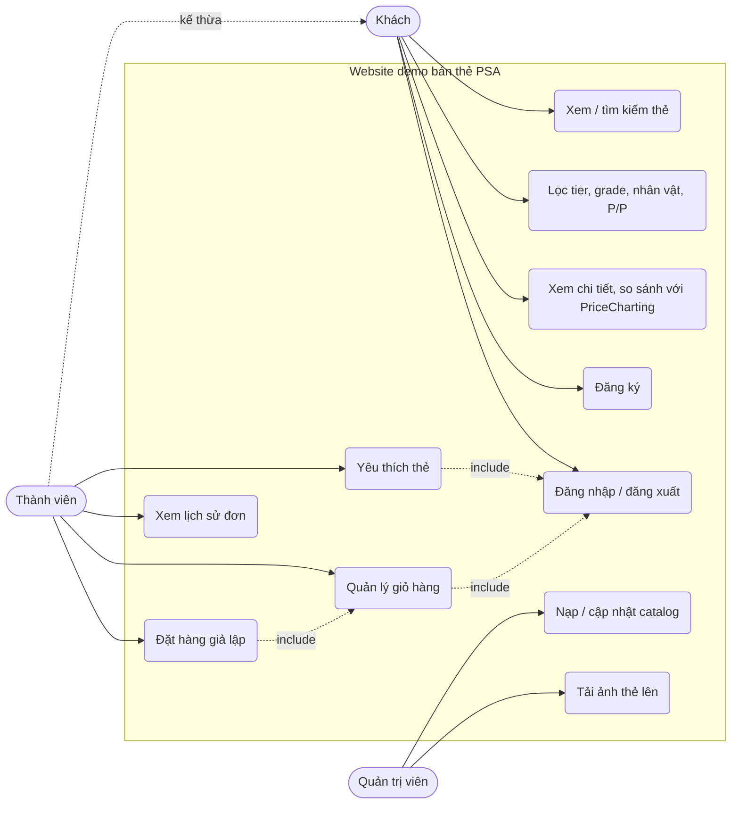
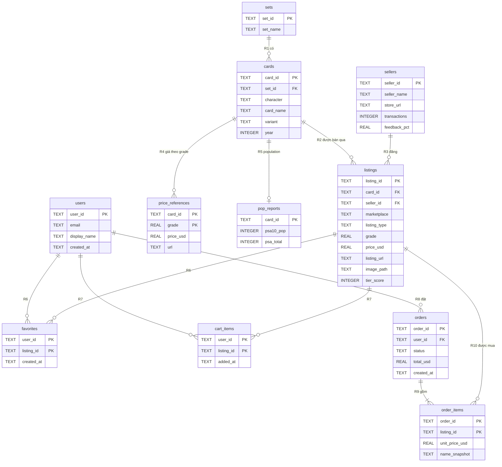

# Phân tích: Use case · ERD · Quan hệ — SQL so với NoSQL (Firestore)

Tài liệu này là bước **thiết kế trước khi code**. Đọc xong bạn sẽ biết:
1. Ai dùng hệ thống và làm gì (use case);
2. Có những thực thể nào và chúng liên hệ với nhau ra sao (ERD);
3. Cùng một quan hệ đó, SQL lưu thế nào và Firestore lưu thế nào, vì sao khác nhau.

Số liệu trong tài liệu đo trực tiếp từ `data/catalog/catalog.json`: **535 listing, 44 set, 37 seller**. Riêng "Official PSA Store" xuất hiện **338 lần**, "Fanatics Collect Vault" **144 lần**.

---

## 1. Use case

### 1.1 Actor

| Actor | Là ai | Firebase nhận biết bằng |
|---|---|---|
| **Khách** | Người chưa đăng nhập | `request.auth == null` |
| **Thành viên** | Đã đăng nhập (email/Google) | `request.auth.uid` |
| **Quản trị viên** | Người nạp và cập nhật catalog | Admin SDK trên máy dev (bỏ qua Rules), sau này có thể dùng custom claim `admin` |

### 1.2 Sơ đồ



### 1.3 Use case → dịch vụ Firebase

Bảng này là "bản đồ" cho cả lộ trình: mỗi use case cần dịch vụ nào.

| Use case | Actor | Auth | Firestore đọc | Firestore ghi | Storage | Hosting |
|---|---|---|---|---|---|---|
| UC1–UC3 Xem, lọc, chi tiết | Khách | — | `cards` | — | đọc ảnh | trang HTML |
| UC4 Đăng ký | Khách | tạo user | — | `users/{uid}` | — | ✓ |
| UC5 Đăng nhập | Khách | ✓ | — | — | — | ✓ |
| UC6 Yêu thích | Thành viên | ✓ | `users/{uid}/favorites` | `users/{uid}/favorites` | — | ✓ |
| UC7 Giỏ hàng | Thành viên | ✓ | `cards/{id}` (lấy giá thật), `users/{uid}/cart` | `users/{uid}/cart` | — | ✓ |
| UC8 Đặt hàng | Thành viên | ✓ | `users/{uid}/cart` | `orders` + xóa `cart` (1 batch) | — | ✓ |
| UC9 Lịch sử đơn | Thành viên | ✓ | `orders where userId == uid` | — | — | ✓ |
| UC10 Nạp catalog | Admin | — (Admin SDK) | — | `cards` | — | — |
| UC11 Tải ảnh | Admin | — (Admin SDK / CLI) | — | `cards.imageUrl` | ghi `cards/{id}.webp` | — |

---

## 2. Thực thể và quan hệ (mức nghiệp vụ, chưa nói SQL hay NoSQL)

Mỗi object trong `catalog.json` thực chất **trộn lẫn 6 thực thể**. Thêm phần bán hàng thì có thêm 5.

| Thực thể | Lấy từ field nào trong catalog | Ghi chú |
|---|---|---|
| **Set** | `set` | 44 set |
| **Card** (bản in thẻ) | `character`, `name`, `variant`, `year` | `year` thuộc Card, không thuộc Set: set "Jungle" có cả bản 1996 (Nhật) và 1999 (Mỹ) |
| **Seller** | `seller`, `sellerHref`, `sellerBadge`, `sellerTransactions`, `sellerFeedback` | 37 seller, lặp rất nhiều |
| **Listing** (tin đăng bán 1 slab) | `id`, `grade`, `listingPriceUSD`, `listingUrl`, `listingType`, `image`, `tierScore` | 535 listing |
| **PriceReference** | `pricecharting`, `priceChartingUrl` | phụ thuộc **(card, grade)**, không phụ thuộc listing |
| **PopReport** | `psa10pop`, `psaTotal` | phụ thuộc card |
| **User** | — | Firebase Auth tạo ra |
| **Favorite** | — | user thích listing |
| **CartItem** | — | listing đang nằm trong giỏ của user |
| **Order** | — | đơn đặt hàng |
| **OrderItem** | — | từng dòng trong đơn |

Field **không lưu** vì tính ra được: `tier` (từ `tierScore`), `diffPercent`, `priceDiffUSD`, `dealRating` (từ giá listing và giá PriceCharting).

### Quan hệ

| # | Quan hệ | Loại | Diễn giải |
|---|---|---|---|
| R1 | Set — Card | 1–n | Một set có nhiều thẻ |
| R2 | Card — Listing | 1–n | Một thẻ có thể đang được bán ở nhiều tin (nhiều grade, nhiều sàn) |
| R3 | Seller — Listing | 1–n | Một seller đăng nhiều tin |
| R4 | Card — PriceReference | 1–n | Mỗi grade một giá tham chiếu |
| R5 | Card — PopReport | 1–1 (0..1) | |
| R6 | User — Listing qua Favorite | **n–n** | |
| R7 | User — Listing qua CartItem | **n–n** | |
| R8 | User — Order | 1–n | |
| R9 | Order — OrderItem | 1–n (ít nhất 1) | |
| R10 | Listing — OrderItem | 1–n | |

---

## 3. ERD theo SQL (chuẩn hóa 3NF)

Mục tiêu của SQL: **mỗi sự thật lưu đúng một chỗ**, nối lại bằng khóa ngoại và JOIN.



Điểm cần nhớ:
- Quan hệ **n–n** (R6, R7) trong SQL **bắt buộc** có bảng nối (`favorites`, `cart_items`) với khóa chính ghép.
- `order_items.unit_price_usd` và `name_snapshot` là **phi chuẩn hóa có chủ đích**: giá listing thay đổi thì đơn cũ vẫn phải giữ số tiền lúc đặt.
- Hiển thị 1 thẻ đầy đủ = JOIN `listings` + `cards` + `sets` + `sellers` + `price_references` + `pop_reports`.

---

## 4. Mô hình NoSQL (Cloud Firestore)

### 4.1 Nguyên tắc thiết kế Firestore

1. **Thiết kế theo màn hình đọc dữ liệu**, không theo thực thể. Firestore không có JOIN.
2. Firestore **tính tiền theo số document đọc/ghi**. Gói Spark miễn phí mỗi ngày: 50.000 lượt đọc, 20.000 lượt ghi, 20.000 lượt xóa, 1 GiB dữ liệu.
3. Mỗi document tối đa **1 MiB**.
4. Ba cách biểu diễn quan hệ:
   - **Nhúng (embed)**: chép dữ liệu con vào trong document cha dưới dạng map/mảng. Đọc nhanh, nhưng sửa phải sửa nhiều chỗ.
   - **Subcollection**: collection con nằm dưới một document, ví dụ `users/{uid}/cart`. Dùng cho dữ liệu "thuộc về" cha, số lượng không giới hạn.
   - **Tham chiếu (reference)**: lưu id, ví dụ `orders.userId`. Muốn lấy dữ liệu bên kia thì phải đọc thêm.

### 4.2 Cây collection

```text
cards/{listingId}                 ← 535 document, ai cũng đọc được
  ├─ set, year, character, name, variant, grade ...
  ├─ seller: { name, href, transactions, feedback }      (nhúng R3)
  ├─ priceRef: { source: "pricecharting", priceUSD, url } (nhúng R4, đúng grade của listing)
  ├─ pop: { psa10, total }                                (nhúng R5)
  └─ imagePath / imageUrl                                 (ảnh trên Storage)

users/{uid}                       ← 1 document / người dùng
  ├─ favorites/{listingId}        ← subcollection (R6)
  └─ cart/{listingId}             ← subcollection (R7)

orders/{orderId}                  ← collection gốc, có userId (R8)
  └─ items: [ {...}, {...} ]      ← mảng map nhúng (R9 + snapshot R10)
```

### 4.3 Document mẫu

Lấy từ dữ liệu thật, listing `ebay-306951178456`:

```jsonc
// cards/ebay-306951178456
{
  "name": "SWORD & SHIELD CHILLING REIGN SECRET #224 FULL ART/SNORLAX",
  "character": "Snorlax",
  "set": "Sword & Shield",
  "year": 2021,
  "variant": "Full Art",
  "grade": 10,
  "gradeLabel": "PSA 10 GEM MT",
  "slabCompany": "PSA",
  "tierScore": 71,
  "marketplace": "ebay",
  "listingType": "BUY_IT_NOW",
  "listingPriceUSD": 406.84,
  "listingUrl": "https://www.ebay.com/itm/306951178456?...",
  "seller": {
    "name": "Official PSA Store",
    "href": "https://www.ebay.com/str/psa",
    "transactions": 165000,
    "feedback": 99.8
  },
  "priceRef": { "source": "pricecharting", "priceUSD": 45, "url": "" },
  "pop": { "psa10": 150, "total": 450 },
  "imagePath": "cards/ebay-306951178456.webp"
}
```

```jsonc
// users/{uid}
{ "email": "a@test.com", "displayName": "An", "createdAt": <serverTimestamp> }

// users/{uid}/favorites/ebay-306951178456
{ "addedAt": <serverTimestamp> }

// users/{uid}/cart/ebay-306951178456
{ "name": "SWORD & SHIELD ... SNORLAX", "priceUSD": 406.84, "imagePath": "cards/ebay-306951178456.webp", "addedAt": <serverTimestamp> }

// orders/{auto-id}
{
  "userId": "<uid>",
  "status": "pending",
  "totalUSD": 406.84,
  "createdAt": <serverTimestamp>,
  "items": [
    { "listingId": "ebay-306951178456", "name": "SWORD & SHIELD ... SNORLAX", "priceUSD": 406.84, "grade": 10 }
  ]
}
```

> Giá trong document mẫu là giá thật trong catalog, không phải số minh họa. Khi seed lên Firestore cũng phải giữ nguyên `null` nếu catalog là `null` (xem `.claude/rules/data-integrity.md`).

---

## 5. Cùng một quan hệ: SQL lưu thế nào, Firestore lưu thế nào

Đây là phần quan trọng nhất của bài.

| Quan hệ | SQL | Firestore | Vì sao chọn cách đó |
|---|---|---|---|
| R1 Set — Card | bảng `sets` + FK | **nhúng** chuỗi `set` vào card | Set chỉ có tên, không có thông tin gì thêm; tách ra chỉ tốn thêm lượt đọc |
| R2 Card — Listing | bảng `cards` + FK | **gộp** card vào listing (1 document = 1 listing) | Màn hình luôn hiện listing kèm thông tin thẻ |
| R3 Seller — Listing | bảng `sellers` + FK | **nhúng** map `seller` | Đọc 1 document là đủ. Cái giá: sửa feedback của "Official PSA Store" phải sửa **338 document** |
| R4 Card — PriceReference | bảng riêng, khóa (card, grade) | **nhúng** `priceRef` đúng grade của listing | Mỗi listing chỉ cần đúng 1 giá tham chiếu |
| R5 Card — PopReport | bảng 1–1 | **nhúng** `pop` | Luôn đọc cùng nhau |
| R6 User — Listing (Favorite) | bảng nối `favorites` | **subcollection** `users/{uid}/favorites/{listingId}` | Không cần bảng nối; id document = listingId nên tự chống trùng |
| R7 User — Listing (Cart) | bảng nối `cart_items` | **subcollection** `users/{uid}/cart/{listingId}` | Như trên; Rules phân quyền theo đường dẫn rất dễ |
| R8 User — Order | FK `orders.user_id` | **tham chiếu** `orders.userId` (collection gốc) | Để sau này admin query được mọi đơn; Rules kiểm tra `userId == auth.uid` |
| R9 Order — OrderItem | bảng `order_items` | **nhúng** mảng `items[]` | Đơn luôn đọc trọn vẹn, số dòng ít, không sửa sau khi tạo |
| R10 Listing — OrderItem | FK + `unit_price_usd` | chụp `listingId`, `name`, `priceUSD` vào `items[]` | Giống SQL: lưu bản sao giá lúc đặt |

### Quy tắc chọn nhúng hay tách

| Câu hỏi | Trả lời "có" → |
|---|---|
| Luôn đọc cùng document cha? | Nhúng |
| Dữ liệu con có thể tăng không giới hạn (hàng nghìn)? | Subcollection |
| Dữ liệu con hay bị sửa và dùng chung bởi nhiều cha? | Tách + tham chiếu (hoặc chấp nhận sửa nhiều chỗ) |
| Cần query trên toàn bộ dữ liệu con của mọi người dùng? | Collection gốc có field tham chiếu (như `orders.userId`) |
| Cần phân quyền theo người dùng? | Đặt dưới `users/{uid}/...` để Rules chỉ cần so `uid` |

### So sánh tổng quát

| Tiêu chí | SQL | Firestore |
|---|---|---|
| Hiển thị 1 thẻ đầy đủ | JOIN 6 bảng | Đọc 1 document |
| Sửa thông tin 1 seller | 1 dòng | 338 document |
| Báo cáo tùy ý (GROUP BY, SUM) | Mạnh | Yếu, phải thiết kế trước hoặc tính sẵn |
| Ràng buộc toàn vẹn | FOREIGN KEY, CHECK, transaction | Security Rules + code, có `writeBatch`/transaction |
| Phân quyền theo người dùng | Tự viết trong API | Auth + Rules tích hợp sẵn |
| Truy cập từ trình duyệt | Phải có server ở giữa | Gọi thẳng, Rules bảo vệ |
| Realtime | Tự làm | `onSnapshot` có sẵn |

---

## 6. Truy vấn theo màn hình (access patterns)

| Màn hình | Truy vấn Firestore | Số lượt đọc |
|---|---|---|
| Trang chủ | App build tĩnh từ catalog → 0 lượt; nếu đọc từ Firestore: `getDocs(collection(db,'cards'))` | 0 hoặc 535 / lần tải |
| Chi tiết thẻ | `getDoc(doc(db,'cards',id))` | 1 |
| Trái tim yêu thích | `onSnapshot(collection(db,'users',uid,'favorites'))` | = số thẻ đã thích |
| Giỏ hàng | `onSnapshot(collection(db,'users',uid,'cart'))` | = số món trong giỏ |
| Thêm vào giỏ | `getDoc(cards/{id})` để lấy **giá thật**, rồi `setDoc(cart/{id})` | 1 đọc, 1 ghi |
| Đặt hàng | `writeBatch`: tạo `orders/{id}` + xóa từng `cart/{id}` | 1 + n ghi |
| Lịch sử đơn | `query(collection(db,'orders'), where('userId','==',uid))` | = số đơn |

Lưu ý: nếu thêm `orderBy('createdAt','desc')` vào query lịch sử đơn, Firestore sẽ yêu cầu tạo **composite index** (`userId` + `createdAt`). Lỗi trả về có sẵn link tạo index.

---

## 7. Ma trận phân quyền (nền tảng cho Security Rules)

| Đường dẫn | Khách | Thành viên (chủ sở hữu) | Thành viên khác | Admin SDK |
|---|---|---|---|---|
| `cards/{id}` | đọc | đọc | đọc | đọc/ghi |
| `users/{uid}` và subcollection | ✗ | đọc/ghi | ✗ | đọc/ghi |
| `orders/{id}` | ✗ | tạo (khi `userId == uid`, `status == 'pending'`, `items.size() > 0`), đọc | ✗ | đọc/ghi |
| Sửa/xóa `orders` | ✗ | ✗ | ✗ | ✓ |
| Storage `cards/*` (ảnh) | đọc | đọc | đọc | ghi |

Admin SDK (script chạy trên máy với service account) **bỏ qua mọi Rules**, nên service account key là bí mật tuyệt đối.

---

## 8. Ảnh thẻ: lưu ở đâu

Hiện tại 535 ảnh nằm ở `public/assets/cards/*.webp` (thư mục `public/` khoảng 47 MB) và được phục vụ cùng trang web.

| Phương án | Chi phí | Ưu | Nhược |
|---|---|---|---|
| A. Để trong `public/`, Hosting phục vụ | Miễn phí (Spark: 10 GB lưu, 360 MB/ngày tải) | Không cần làm gì | Muốn thêm ảnh phải build và deploy lại |
| B. Cloud Storage for Firebase | Cần **gói Blaze** (gắn thẻ thanh toán), có hạn mức miễn phí | Upload ảnh động, có Storage Rules | Phải gắn billing, nên đặt cảnh báo ngân sách |

Document `cards` lưu `imagePath` (đường dẫn trong bucket, ví dụ `cards/ebay-306951178456.webp`) thay vì URL đầy đủ, để đổi bucket hoặc CDN mà không phải sửa dữ liệu. Chi tiết về Blaze sẽ bàn ở Giai đoạn 4 trong [00-lo-trinh.md](00-lo-trinh.md).
