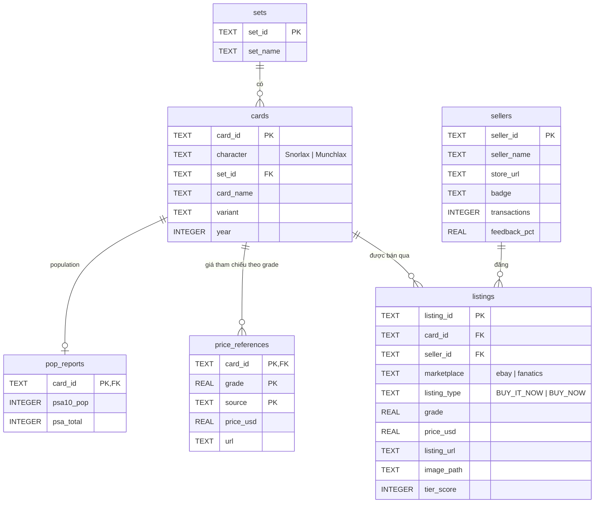
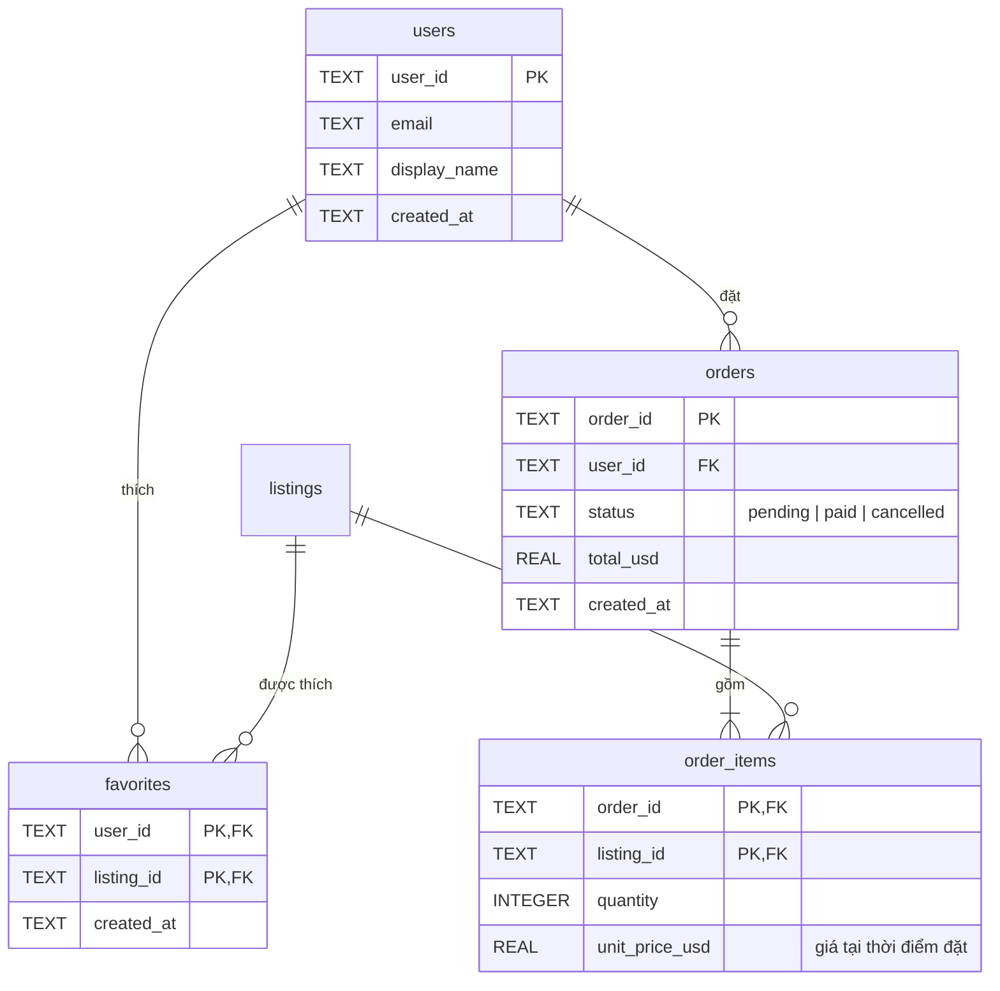

# ERD — Catalog thẻ PSA (sau chuẩn hóa)

## Từ 1 bảng phẳng thành 6 bảng

Mỗi object trong `data/catalog/catalog.json` trộn lẫn nhiều thực thể. Ví dụ, thông tin seller "Official PSA Store" bị lặp lại ở **338 dòng**. Khi cần sửa số giao dịch của seller này, ta phải sửa 338 chỗ (**update anomaly**).

| Nhóm field trong JSON | Phụ thuộc vào | Bảng |
|---|---|---|
| `set` | tên set | `sets` |
| `character`, `name`, `variant`, `year` | bản in thẻ | `cards` |
| `seller`, `sellerHref`, `sellerBadge`, `sellerTransactions`, `sellerFeedback` | người bán | `sellers` |
| `id`, `grade`, `listingPriceUSD`, `listingUrl`, `image`, `tierScore`… | tin đăng bán | `listings` |
| `pricecharting`, `priceChartingUrl` | (thẻ, grade) | `price_references` |
| `psa10pop`, `psaTotal` | thẻ | `pop_reports` |
| `tier`, `diffPercent`, `dealRating` | **tính ra được** từ các cột khác | không lưu, dùng VIEW `v_listing_deals` |

Lưu ý: `year` thuộc bảng `cards` chứ không thuộc `sets`, vì cùng tên set "Jungle" có cả bản Nhật 1996 và bản Mỹ 1999. Đây là một phụ thuộc hàm (functional dependency) mà ta chỉ phát hiện được khi nhìn vào dữ liệu thật.

## Sơ đồ

## Mở rộng cho website bán thẻ

- `favorites` là bảng nối của quan hệ **n–n** giữa `users` và `listings`.
- `order_items.unit_price_usd` lưu **bản sao giá lúc đặt hàng**. Đây là phi chuẩn hóa có chủ đích: giá listing đổi về sau thì đơn cũ vẫn phải giữ đúng số tiền đã đặt.
