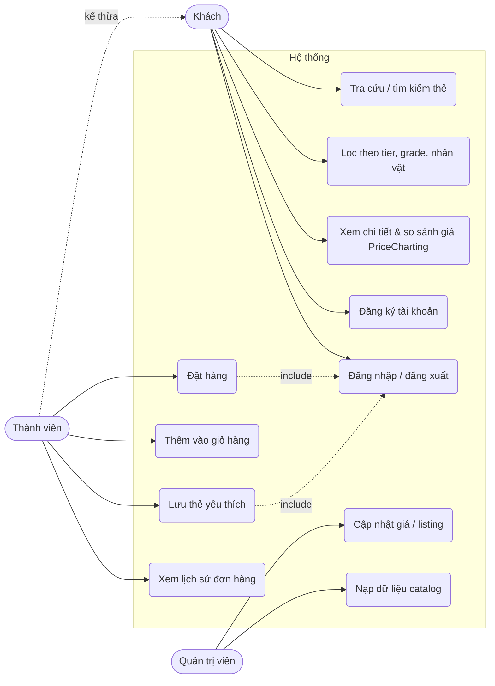

# Sơ đồ Use Case — Website tra cứu & bán thẻ PSA

| Use case | Actor | Bảng đọc | Bảng ghi |
|---|---|---|---|
| Tra cứu, lọc, xem chi tiết | Khách | listings, cards, sets, sellers, price_references, pop_reports | — |
| Đăng ký / đăng nhập | Khách | users | users |
| Yêu thích | Thành viên | favorites | favorites |
| Giỏ hàng, đặt hàng | Thành viên | listings | orders, order_items |
| Lịch sử đơn | Thành viên | orders, order_items | — |
| Cập nhật giá, nạp catalog | Quản trị viên | — | listings, price_references, … |

Bài tập: mỗi use case cần những câu SQL nào? Hãy viết ít nhất 1 câu cho UC2, UC6, UC8 (gợi ý: UC8 cần `INSERT` vào 2 bảng, nên đặt trong một **transaction**).
